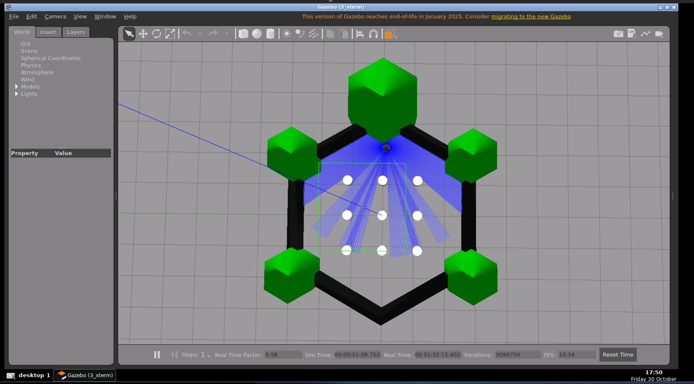

# TurtleBot3 Autonomous Navigation using ROS 2 Nav2

## Project Overview

This project demonstrates autonomous navigation of a *TurtleBot3 Burger* robot in a Gazebo simulation environment using *ROS 2 Humble* and the *Navigation2 (Nav2)* framework.

## Technologies Used

* ROS 2 Humble
* TurtleBot3 Burger
* Gazebo
* RViz2
* Navigation2 (Nav2)
* LiDAR Sensor

## Implementation

* Launched the TurtleBot3 Burger simulation in Gazebo.
* Used RViz2 for robot and map visualization.
* Initialized the robot's position using *2D Pose Estimate*.
* Set navigation goals using the *Nav2 Goal* tool.
* Used LiDAR sensor data for obstacle detection.
* Demonstrated autonomous navigation and obstacle avoidance.

## Setup and Execution

### 1. Launch Gazebo Simulation

Open a terminal and execute:

```bash
export TURTLEBOT3_MODEL=burger
ros2 launch turtlebot3_gazebo turtlebot3_world.launch.py
```

### 2. Launch Navigation2

Open another terminal and execute:

```bash
export TURTLEBOT3_MODEL=burger

ros2 launch turtlebot3_navigation2 navigation2.launch.py \
use_sim_time:=True \
map:=/opt/ros/humble/share/turtlebot3_navigation2/map/map.yaml
```

### 3. Perform Autonomous Navigation

1. Set the robot's initial pose in RViz2 using *2D Pose Estimate*.
2. Select a destination using *Nav2 Goal*.
3. Observe the robot navigating autonomously while avoiding obstacles.

## Demonstration

The demonstration includes:

* TurtleBot3 simulation in Gazebo.
* Autonomous navigation to a selected goal.
* LiDAR sensor visualization.
* Obstacle detection and avoidance.

## Learning Outcomes

* Understanding ROS 2 navigation workflows.
* Working with Gazebo and RViz2.
* Using Nav2 for autonomous navigation.
* Understanding LiDAR-based obstacle detection.
* Exploring robot localization and goal navigation.

## Project Evidence

### Gazebo Simulation



### RViz2 Navigation


### LiDAR Visualization


### Video Demonstration

[Watch the Autonomous Navigation Demo](YOUR_VIDEO_LINK)
