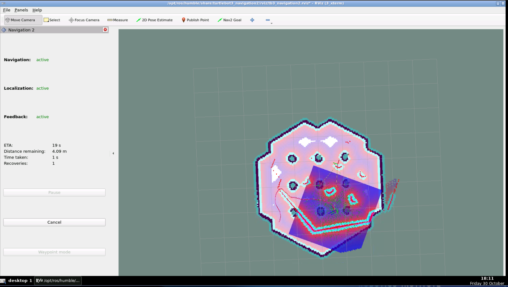

# TurtleBot3 Autonomous Navigation using ROS 2 Nav2

## Project Overview

This project demonstrates autonomous navigation of a *TurtleBot3 Burger* robot in a Gazebo simulation environment using *ROS 2 Humble* and the *Navigation2 (Nav2)* framework. The robot navigates towards a selected goal while detecting and avoiding obstacles using LiDAR sensor data.


## Technologies Used

* ROS 2 Humble
* TurtleBot3 Burger
* Gazebo
* RViz2
* Navigation2 (Nav2)
* LiDAR Sensor


## Prerequisites

Ensure the following environment and packages are available:

* Ubuntu 22.04 LTS
* ROS 2 Humble
* TurtleBot3 simulation packages
* TurtleBot3 Navigation2 packages
* Gazebo and RViz2

## Implementation

* Launched the TurtleBot3 Burger simulation in Gazebo.
* Used RViz2 for robot and map visualization.
* Initialized the robot's position using **2D Pose Estimate**.
* Set navigation goals using the **Nav2 Goal** tool.
* Used LiDAR sensor data for obstacle detection.
* Demonstrated autonomous navigation and obstacle avoidance using the existing Nav2 framework.


## Approach

1. Started the TurtleBot3 Burger simulation in Gazebo.
2. Launched the Navigation2 stack with the provided map.
3. Initialized the robot's position using 2D Pose Estimate in RViz2.
4. Selected a destination using the Nav2 Goal tool.
5. Observed the robot planning and following a path towards the selected goal.
6. Monitored LiDAR sensor data for obstacle detection and observed obstacle avoidance during navigation.

The project uses the existing ROS 2 Nav2 navigation framework and its configured navigation components rather than implementing a custom navigation algorithm.

## Setup and Execution

### 1. Launch Gazebo Simulation

Open a terminal and execute:

```bash
export TURTLEBOT3_MODEL=burger
ros2 launch turtlebot3_gazebo turtlebot3_world.launch.py
```

### 2. Launch Navigation2

Open another terminal and execute:

```bash
export TURTLEBOT3_MODEL=burger

ros2 launch turtlebot3_navigation2 navigation2.launch.py \
use_sim_time:=True \
map:=/opt/ros/humble/share/turtlebot3_navigation2/map/map.yaml
```

### 3. Perform Autonomous Navigation

1. Set the robot's initial pose in RViz2 using *2D Pose Estimate*.
2. Select a destination using *Nav2 Goal*.
3. Observe the robot navigating autonomously while avoiding obstacles.


### Challenges Faced
* Setting the correct initial robot pose in RViz2.
* Understanding the integration of Gazebo, RViz2, and the Nav2 navigation stack.
* Troubleshooting LiDAR visualization in Gazebo.
* Understanding how sensor data supports obstacle detection and navigation.
  
These challenges improved my understanding of ROS 2 simulation, robot localization, sensor visualization, and troubleshooting.

## Demonstration

The demonstration includes:

* TurtleBot3 simulation in Gazebo.
* Autonomous navigation to a selected goal.
* LiDAR sensor visualization.
* Obstacle detection and avoidance.

## Learning Outcomes

* Understanding ROS 2 navigation workflows.
* Working with Gazebo and RViz2.
* Using Nav2 for autonomous navigation.
* Understanding LiDAR-based obstacle detection.
* Exploring robot localization and goal navigation.
* Understanding the integration of simulation and navigation components.

## Project Evidence

## Simulation in Gazebo
[](screenshots/gazebo_simulation.png)

## Autonomous Navigation in RViz2
[](screenshots/rviz2_navigation.png)


### Video Demonstration

[Watch the Autonomous Navigation Demo](https://drive.google.com/file/d/1asOmudZx6wdWl1uYLhCeEeaQI_n6bwt7/view?usp=drivesdk)
